# AWS Grafana Observability Lab

## Infrastructure monitoring and proactive incident alerting for AWS, built with Prometheus, Grafana, CloudWatch and Terraform.
A hands-on AWS observability project that provisions cloud infrastructure using Terraform, collects Linux host metrics with Prometheus Node Exporter, visualizes infrastructure performance through Grafana, and implements incident alerting using Amazon CloudWatch and SNS.

The monitoring stack runs locally in Docker on Kali Linux and securely connects to the AWS EC2 instance through AWS Systems Manager (SSM) port forwarding. This eliminates the need to expose monitoring ports or SSH access to the public internet.


*Infrastructure monitoring dashboard — screenshot to be added.*

---

## 1. Project Overview

Cloud infrastructure requires continuous monitoring to maintain availability, performance and reliability.

Without centralized observability, engineering teams may only discover infrastructure problems after applications become slow, services become unavailable or users report failures.

This project demonstrates how open-source monitoring tools and AWS-native services can work together to provide infrastructure visibility, proactive incident detection and operational awareness.

### Problems addressed

- Limited visibility into EC2 infrastructure performance.
- Delayed detection of CPU and memory pressure.
- Unexpected disk capacity exhaustion.
- Infrastructure availability and health issues.
- Manual investigation of infrastructure incidents.
- Lack of centralized monitoring and alert notifications.

### Project objectives

| Objective | Implementation |
|---|---|
| Infrastructure visibility | Grafana dashboards |
| Metrics collection | Prometheus and Node Exporter |
| AWS monitoring | Amazon CloudWatch |
| Incident alerting | CloudWatch Alarms and SNS |
| Secure connectivity | AWS Systems Manager |
| Infrastructure automation | Terraform |
| Local deployment | Docker Compose |

## 2. Architecture

The monitoring environment runs locally on Kali Linux, while the monitored workload runs on an Ubuntu 24.04 EC2 instance in AWS `us-east-1`.

Prometheus collects Linux metrics through an SSM port-forwarding session. Grafana provides a centralized visualization layer for Prometheus and CloudWatch data.

```mermaid
flowchart TB
    subgraph LOCAL["Kali Linux - Monitoring Environment"]
        G["Grafana<br/>Dashboards"]
        P["Prometheus<br/>Metrics Collection"]
        D["Docker Compose"]
        D --> G
        D --> P
        G --> P
    end

    subgraph AWS["AWS Cloud - us-east-1"]
        EC2["EC2 Ubuntu 24.04"]
        NE["Node Exporter<br/>Port 9100"]
        CW["Amazon CloudWatch"]
        ALARM["CloudWatch Alarms"]
        SNS["Amazon SNS"]
        EMAIL["Email Notifications"]

        EC2 --> NE
        EC2 --> CW
        CW --> ALARM
        ALARM --> SNS
        SNS --> EMAIL
    end

    SSM["AWS Systems Manager<br/>Secure Port Forwarding"]

    NE --> SSM
    SSM --> P
    CW -.-> G

    TF["Terraform<br/>Infrastructure as Code"]
    TF --> EC2
    TF --> CW
    TF --> ALARM
    TF --> SNS
```



### How it works

1. Terraform provisions the EC2 instance, IAM role, security group and supporting AWS resources.
2. EC2 user data installs and starts Prometheus Node Exporter.
3. AWS Systems Manager establishes secure port forwarding from the EC2 instance to the local monitoring environment.
4. Prometheus scrapes Node Exporter metrics through the local tunnel.
5. Grafana visualizes infrastructure metrics collected by Prometheus.
6. CloudWatch monitors AWS infrastructure metrics and evaluates configured alarms.
7. CloudWatch alarms publish notifications to an SNS topic.
8. SNS delivers incident notifications to the configured email address.

## 3. Technology Stack

| Technology | Purpose |
|---|---|
| AWS EC2 | Hosts the monitored Linux workload |
| AWS Systems Manager | Secure instance access and port forwarding |
| Amazon CloudWatch | AWS infrastructure metrics and alarms |
| Amazon SNS | Incident notifications |
| Terraform | Infrastructure as Code |
| Prometheus | Metrics collection and time-series storage |
| Node Exporter | Linux host metrics |
| Grafana | Infrastructure dashboards and visualization |
| Docker Compose | Local monitoring stack |
| Bash | Deployment and health-check automation |
| Python | Planned monitoring and reporting automation |
| Kali Linux | Local development and monitoring environment |

## 4. Infrastructure Monitoring

The project focuses on collecting and visualizing infrastructure health indicators.

| Monitoring area | Metrics | Collection source |
|---|---|---|
| CPU | Utilization, load average | Node Exporter, CloudWatch |
| Memory | Used memory, available memory, swap | Node Exporter |
| Disk | Filesystem utilization, free space, I/O | Node Exporter |
| Network | Received and transmitted bytes, errors | Node Exporter, CloudWatch |
| Availability | Uptime, scrape status, EC2 status checks | Prometheus, CloudWatch |

### Example Prometheus queries

CPU utilization:

```promql
100 * (1 - avg by(instance) (
  rate(node_cpu_seconds_total{mode="idle"}[5m])
))
```

Available memory percentage:

```promql
100 * (
  node_memory_MemAvailable_bytes /
  node_memory_MemTotal_bytes
)
```

Filesystem utilization:

```promql
100 * (
  1 -
  node_filesystem_avail_bytes{fstype!~"tmpfs|overlay"}
  /
  node_filesystem_size_bytes{fstype!~"tmpfs|overlay"}
)
```

Node Exporter availability:

```promql
up{job="aws-ec2"}
```

## 5. Alerting and Incident Detection

The project uses AWS CloudWatch for AWS-native monitoring and Prometheus for Linux host metrics.

| Alert | Condition | Notification path |
|---|---|---|
| High CPU | CPU exceeds configured threshold | CloudWatch Alarm → SNS |
| Instance unhealthy | EC2 status check failure | CloudWatch Alarm → SNS |
| Memory pressure | Available memory falls below configured threshold | Prometheus alert rule |
| Disk filling up | Available filesystem space falls below configured threshold | Prometheus alert rule |
| Monitoring target down | Node Exporter scrape fails | Prometheus alert rule |

**Important:** Prometheus alert rules evaluate conditions but require Alertmanager or another notification integration to deliver notifications. CloudWatch does not automatically collect EC2 memory and filesystem utilization from the default EC2 metrics. These require Node Exporter or the CloudWatch Agent.

Thresholds and notification routing will be documented once implemented and tested.

## 6. Security Design

Security is an important part of the infrastructure design.

The EC2 instance is configured to avoid publicly exposed monitoring and administration ports.

Security controls include:

- No inbound SSH security group rules.
- No publicly exposed Node Exporter port.
- AWS Systems Manager for remote access.
- IAM instance profile with `AmazonSSMManagedInstanceCore`.
- Encrypted EBS root volume.
- IMDSv2 enforcement.
- Local Grafana and Prometheus port bindings.
- Sensitive credentials excluded from Git.
- Restricted access to monitoring interfaces.

This approach demonstrates secure infrastructure administration without relying on publicly accessible management endpoints.

## 7. Repository Structure

```text
aws-grafana-observability-lab/
│
├── docker-compose.yml
├── .env
├── .gitignore
│
├── prometheus/
│   └── prometheus.yml
│
├── grafana/
│   ├── dashboards/
│   └── provisioning/
│       ├── datasources/
│       │   └── datasource.yml
│       └── dashboards/
│           └── dashboard.yml
│
├── terraform/
│   ├── main.tf
│   ├── variables.tf
│   ├── outputs.tf
│   ├── security.tf
│   └── monitoring.tf
│
├── scripts/
│   ├── setup.sh
│   └── health-check.sh
│
├── docs/
│   └── images/
│       └── grafana-dashboard.png
│
└── README.md
```

## 8. Deployment Guide

### Prerequisites

- AWS account with appropriate IAM permissions.
- Kali Linux or another Linux distribution.
- AWS CLI configured.
- Terraform installed.
- Docker and Docker Compose installed.
- AWS Systems Manager Session Manager plugin installed.

### Step 1: Clone the repository

```bash
git clone https://github.com/Copubah/aws-grafana-observability-lab.git

cd aws-grafana-observability-lab
```

### Step 2: Configure environment variables

Create a local environment file:

```bash
cp .env.example .env
```

Set a strong Grafana password in `.env`.

Restrict access to the file:

```bash
chmod 600 .env
```

### Step 3: Start the monitoring stack

```bash
docker compose pull

docker compose up -d
```

Check running containers:

```bash
docker compose ps
```

Verify Grafana:

```bash
curl http://localhost:3000/api/health
```

Verify Prometheus:

```bash
curl http://localhost:9090/-/healthy
```

### Step 4: Provision AWS infrastructure

Navigate to the Terraform directory:

```bash
cd terraform
```

Initialize Terraform:

```bash
terraform init
```

Format and validate the configuration:

```bash
terraform fmt -recursive

terraform validate
```

Review the proposed infrastructure:

```bash
terraform plan
```

After reviewing the plan, provision the resources:

```bash
terraform apply
```

### Step 5: Establish secure connectivity

Once the EC2 instance is registered and online in Systems Manager, establish a port-forwarding session.

```bash
aws ssm start-session \
  --region us-east-1 \
  --target INSTANCE_ID \
  --document-name AWS-StartPortForwardingSession \
  --parameters '{"portNumber":["9100"],"localPortNumber":["9100"]}'
```

Replace `INSTANCE_ID` with the instance ID returned by Terraform.

Keep the SSM session running while Prometheus collects metrics.

### Step 6: Verify metrics collection

From another terminal:

```bash
curl http://localhost:9100/metrics
```

Check Prometheus targets:

```text
http://localhost:9090/targets
```

The `aws-ec2` target should report `UP` when the tunnel and Node Exporter are functioning correctly.

### Step 7: Access Grafana

Open:

```text
http://localhost:3000
```

Sign in using the Grafana credentials configured in `.env`.

The Prometheus data source is provisioned through Grafana configuration.

## 9. Expected Business Value

This observability platform demonstrates how engineering teams can improve infrastructure operations through monitoring and proactive incident detection.

Expected benefits include:

- Faster detection of infrastructure degradation.
- Improved visibility into cloud resource utilization.
- Reduced manual infrastructure troubleshooting.
- Better awareness of infrastructure availability.
- More consistent incident notification.
- Improved capacity planning.
- A repeatable infrastructure deployment process.

## 10. Implementation Roadmap

- [x] Create project structure.
- [x] Configure Docker Compose.
- [x] Deploy Grafana locally.
- [x] Deploy Prometheus locally.
- [x] Configure Prometheus data source provisioning.
- [ ] Install and verify Session Manager plugin.
- [ ] Provision AWS EC2 infrastructure.
- [ ] Configure IAM instance profile.
- [ ] Install and verify Node Exporter.
- [ ] Establish SSM port forwarding.
- [ ] Verify Prometheus metric collection.
- [ ] Build Grafana infrastructure dashboards.
- [ ] Configure CloudWatch metrics and alarms.
- [ ] Configure SNS email notifications.
- [ ] Implement Prometheus alert rules.
- [ ] Configure Alertmanager notification routing.
- [ ] Simulate infrastructure incidents.
- [ ] Capture dashboard screenshots.
- [ ] Document deployment and testing results.

## 11. Future Enhancements

Potential extensions to the project include:

| Technology | Planned enhancement |
|---|---|
| Grafana Loki | Centralized log aggregation |
| OpenTelemetry | Application instrumentation |
| Grafana Tempo | Distributed tracing |
| Splunk | Enterprise log analytics |
| Python | Automated monitoring reports |
| AWS Lambda | Event-driven incident response |
| Terraform | Multi-environment infrastructure provisioning |
| Alertmanager | Prometheus alert notification routing |

## 12. Learning Outcomes

This project provides practical experience in:

- AWS infrastructure provisioning.
- Infrastructure as Code using Terraform.
- Linux server administration.
- Containerized application deployment.
- Prometheus metrics collection.
- Grafana dashboard development.
- CloudWatch monitoring and alerting.
- SNS notification integration.
- IAM permissions and security controls.
- AWS Systems Manager administration.
- Cloud observability and incident detection.

## 13. Author

**Charles Opuba**

Cloud Operations | AWS | Linux | Terraform | Observability

GitHub: [github.com/Copubah](https://github.com/Copubah)

